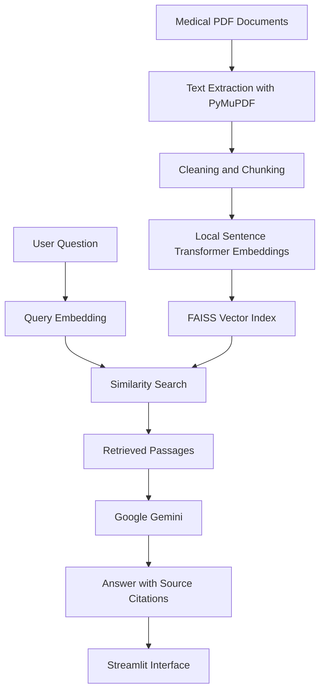

<a id="readme-top"></a>

# MediQuery — Medical Knowledge, Made Accessible

<p align="center">
  <strong>An AI-powered medical knowledge assistant grounded in trusted documents.</strong>
</p>

<p align="center">
  Ask questions. Retrieve relevant evidence. Understand the answer.
</p>

<p align="center">
  <a href="#about-the-project">About</a> ·
  <a href="#features">Features</a> ·
  <a href="#getting-started">Getting Started</a> ·
  <a href="#roadmap">Roadmap</a> ·
  <a href="#contributing">Contributing</a>
</p>

<p align="center">
  
  
  
  
  
</p>

---

## About the Project

MediQuery is an AI-powered medical knowledge assistant designed to answer questions using information retrieved from medical PDF documents supplied by the user.

General-purpose language models can produce fluent answers, but their responses may be unsupported or incorrect. MediQuery explores how **Retrieval-Augmented Generation (RAG)** can improve answer grounding by retrieving relevant document passages before generating a response.

Instead of relying exclusively on a model's parametric knowledge, the system follows a retrieval-first workflow:

1. Ingest medical PDF documents.
2. Extract and clean page-level text.
3. Split text into overlapping chunks.
4. Convert chunks into vector embeddings locally.
5. Retrieve relevant passages using FAISS similarity search.
6. Generate a response using Google Gemini and the retrieved context.
7. Display source document names, page numbers, and retrieved passages.

The current implementation is a working Streamlit prototype. Its modular components are designed to support future improvements in retrieval quality, evaluation, document management, and deployment.

### Project Goals

- Build a practical RAG pipeline from the ground up.
- Understand document processing, embeddings, vector search, and LLM integration.
- Ground generated answers in retrieved evidence.
- Make responses more transparent through source attribution.
- Maintain a modular codebase that can support future improvements.
- Provide a demonstration without relying on the OpenAI API.

> **Important:** MediQuery is an experimental educational project, not a medical device or a substitute for professional medical advice. Generated answers can be inaccurate or incomplete. Medical decisions should be made with qualified healthcare professionals.

## Features

### Core Prototype

- [x] Upload and ingest medical PDF documents through Streamlit.
- [x] Extract page-level text using PyMuPDF.
- [x] Clean whitespace and chunk document text with overlap.
- [x] Generate normalized embeddings with Sentence Transformers.
- [x] Index and retrieve vectors using FAISS.
- [x] Generate context-grounded answers using Google Gemini.
- [x] Display source document names and page citations.
- [x] Inspect retrieved passages and similarity scores.
- [x] Load configuration from environment variables and `.env`.
- [x] Save and reload the local FAISS index and chunk metadata.
- [x] Test core components using pytest.

### Planned Enhancements

- [ ] Robust document IDs and handling of duplicate filenames.
- [ ] Remove and replace documents from the knowledge base.
- [ ] OCR support for scanned PDFs.
- [ ] Retrieval evaluation using Recall@K, Precision@K, and Mean Reciprocal Rank.
- [ ] Answer faithfulness and citation verification.
- [ ] Hybrid retrieval combining semantic and keyword search.
- [ ] Reranking for improved retrieval quality.
- [ ] Improved conversation context and follow-up questions.
- [ ] User-isolated storage, authentication, and access control.
- [ ] Production deployment with persistent storage and monitoring.

*The checklist distinguishes implemented prototype functionality from planned work. Deployment to a hosted environment and production readiness should be verified separately.*

## How It Works



The ingestion pipeline processes documents before a question is submitted. At query time, the system embeds the question, retrieves relevant chunks from the FAISS index, and sends those passages to Gemini as context.

Retrieval quality is a major determinant of answer quality. A fluent response is not necessarily a correct response, so users should inspect cited passages and verify important claims against the original documents.

## Built With

| Technology | Purpose |
|---|---|
| [Python](https://www.python.org/) | Core application language |
| [uv](https://docs.astral.sh/uv/) | Python project and dependency management |
| [Streamlit](https://streamlit.io/) | Interactive web interface |
| [Google Gemini](https://ai.google.dev/gemini-api/docs) | Context-grounded response generation |
| [Sentence Transformers](https://www.sbert.net/) | Local text embedding generation |
| [FAISS](https://github.com/facebookresearch/faiss) | Vector indexing and similarity search |
| [PyMuPDF](https://pymupdf.readthedocs.io/) | PDF text extraction |
| [python-dotenv](https://pypi.org/project/python-dotenv/) | Local environment configuration |
| [pytest](https://docs.pytest.org/) | Automated testing |

The current stack is intended for a local-first prototype. Components can be replaced as the application evolves.

**Cost note:** The prototype does not use the OpenAI API. Gemini API usage may still be subject to quotas, rate limits, model availability, and pricing. Local embedding models require disk space and compute resources, and the model may need to be downloaded on first use.

## Getting Started

Follow these steps to set up the project locally.

### Prerequisites

Make sure you have:

- Python 3.12.
- `uv` installed.
- Git installed.
- A Google AI Studio API key for Gemini access.
- Medical documents that you have permission to use.

### 1. Install uv

If you have not installed `uv`, follow the [official installation guide](https://docs.astral.sh/uv/getting-started/installation/).

On Linux or macOS, you can use:

```bash
curl -LsSf https://astral.sh/uv/install.sh | sh
```

Restart your terminal if needed, then verify the installation:

```bash
uv --version
```

### 2. Clone the Repository

Replace the repository URL with your actual GitHub repository.

```bash
git clone https://github.com/YOUR_USERNAME/mediquery.git
cd mediquery
```

If your GitHub repository has a different name, use that repository URL and directory name.

### 3. Install Dependencies

Install the project and its dependencies using `uv`:

```bash
uv sync
```

This creates or synchronizes the project virtual environment using `pyproject.toml` and `uv.lock`.

Use the dependencies recorded in the project's actual configuration rather than installing an unrelated stack.

### 4. Configure Environment Variables

Create a `.env` file in the project root:

```bash
cp .env.example .env
```

Add your Google Gemini API key and the model/configuration values supported by the project:

```dotenv
GEMINI_API_KEY=your_gemini_api_key_here
GEMINI_MODEL=gemini-2.5-flash

EMBEDDING_MODEL=sentence-transformers/all-MiniLM-L6-v2

CHUNK_SIZE=1200
CHUNK_OVERLAP=200
TOP_K=5
```

Obtain an API key through [Google AI Studio](https://aistudio.google.com/apikey). Choose a Gemini model available to your API account.

Never commit `.env` or expose API keys in source code, screenshots, logs, or public repositories. Keep `.env.example` free of real secrets.

### 5. Run the Application

Start the Streamlit development server:

```bash
uv run streamlit run app.py
```

Open the local URL displayed in the terminal, typically:

```text
http://localhost:8501
```

On first use, the local embedding model may need to be downloaded.

### 6. Run Tests

Run the test suite:

```bash
uv run pytest -v
```

The tests cover the implemented ingestion, chunking, embedding, retrieval, generation, pipeline, configuration, and persistence components.

## Project Structure

The current project separates document processing, retrieval, generation, configuration, and persistence so each component can be improved independently.

```text
mediquery/
├── app.py                         # Streamlit application
├── pyproject.toml                 # Project metadata and dependencies
├── uv.lock                        # Locked dependency versions
├── .python-version                # Python version selection
├── .env.example                   # Example environment configuration
├── .gitignore
├── README.md
├── src/
│   └── medical_rag/
│       ├── __init__.py
│       ├── config.py              # Environment and settings
│       ├── ingestion.py           # PDF text extraction
│       ├── chunking.py            # Text chunking
│       ├── embeddings.py          # Local embedding generation
│       ├── retrieval.py           # FAISS similarity search
│       ├── generation.py          # Gemini integration
│       ├── pipeline.py            # RAG orchestration
│       └── persistence.py         # Local index and metadata storage
├── tests/                         # Automated tests
└── data/
    └── processed/
        └── knowledge_base/        # Generated local index and metadata
```

The knowledge-base directory is generated at runtime. Do not commit uploaded medical documents, generated indexes, or private data to the repository.

## Usage

1. Start the Streamlit application.
2. Upload one or more text-based medical PDF documents in the sidebar.
3. Wait for the documents to be processed and indexed.
4. Enter a question that can be answered from the uploaded documents.
5. Review the generated answer and its source citations.
6. Expand **Inspect retrieved passages** to examine the text and similarity scores used for generation.

For example, a user might ask:

> What symptoms are described for a condition in the uploaded clinical reference?

The answer should be checked against the cited document passages. If the source material does not provide enough information, the system should acknowledge that limitation rather than inventing evidence.

## Configuration

| Variable | Default | Description |
|---|---|---|
| `GEMINI_API_KEY` | Not set | API key for Gemini |
| `GEMINI_MODEL` | `gemini-2.5-flash` | Answer-generation model; availability may vary |
| `EMBEDDING_MODEL` | `sentence-transformers/all-MiniLM-L6-v2` | Local embedding model |
| `CHUNK_SIZE` | `1200` | Target chunk size in characters |
| `CHUNK_OVERLAP` | `200` | Character overlap between chunks |
| `TOP_K` | `5` | Default number of passages retrieved |

Settings are loaded from environment variables and, for local development, the `.env` file.

## Persistence

The prototype saves its knowledge base locally:

```text
data/processed/knowledge_base/
├── index.faiss
└── metadata.json
```

- `index.faiss` stores vectors used for similarity search.
- `metadata.json` stores chunk text, source-page metadata, and document hashes.

The current persistence implementation uses the local filesystem. Data may not survive redeployment on hosting platforms with ephemeral storage. The current document-management design also needs stronger document identity, duplicate-filename handling, and deletion support before it is appropriate for multi-user use.

## Deployment

The Streamlit interface can be deployed using [Streamlit Community Cloud](https://share.streamlit.io/).

High-level deployment steps:

1. Push the project to a GitHub repository.
2. Commit `pyproject.toml`, `uv.lock`, `.python-version`, source files, tests, and this README.
3. Ensure `.env`, uploaded PDFs, and generated knowledge-base files are excluded from Git.
4. Configure `GEMINI_API_KEY` through the hosting platform's secrets interface.
5. Deploy `app.py` as the entry point.
6. Test upload, retrieval, answer generation, citations, and restart behavior.

See the [Streamlit Community Cloud deployment guide](https://docs.streamlit.io/deploy/streamlit-community-cloud/deploy-your-app).

**Deployment warning:** The current app writes a shared index and metadata to local disk. Do not expose it as a public multi-user service with document uploads until document isolation, access control, and storage behavior have been addressed. For an initial demonstration, use non-sensitive documents and restrict access where possible.

## Safety and Responsible Use

Medical information requires particular care. MediQuery follows these development principles:

- **Evidence first:** Answers should be grounded in retrieved documents.
- **Source transparency:** Users should be able to inspect the passages supporting an answer.
- **Honest uncertainty:** The system should acknowledge when evidence is missing.
- **Privacy:** Do not upload identifiable patient records unless appropriate authorization, safeguards, and compliance requirements are in place.
- **No autonomous diagnosis:** The prototype is not intended to diagnose conditions, prescribe treatment, or replace a clinician.
- **Continuous evaluation:** Retrieval failures, unsupported claims, and misleading citations need to be tested.

Retrieval and citations can reduce some risks, but they do not guarantee medical correctness or eliminate hallucinations. Questions and retrieved passages are sent to the configured Gemini API for answer generation; review the provider's applicable data-handling terms before using sensitive information.

## Roadmap

### Phase 1 — Working Prototype

- [x] Initialize the project using `uv`.
- [x] Configure Gemini and environment variables.
- [x] Load and extract text from medical PDFs.
- [x] Implement chunking and local embedding generation.
- [x] Store embeddings and retrieve relevant passages using FAISS.
- [x] Generate answers grounded in retrieved context.
- [x] Display source references in the Streamlit interface.
- [x] Add automated tests for core components.
- [x] Save and reload the local knowledge base.

### Phase 2 — Better Retrieval

- [ ] Experiment with chunk sizes and overlap.
- [ ] Evaluate alternative embedding models.
- [ ] Add metadata filtering and hybrid retrieval.
- [ ] Introduce reranking.
- [ ] Measure retrieval precision and recall.
- [ ] Build a small evaluation dataset.
- [ ] Evaluate answer faithfulness and citation correctness.

### Phase 3 — User Experience and Document Management

- [x] Build a basic web interface.
- [x] Support PDF uploads and indexing status.
- [x] Display citations alongside answers.
- [ ] Add robust document IDs and duplicate-filename handling.
- [ ] Support document removal and replacement.
- [ ] Add OCR for scanned PDFs.
- [ ] Improve conversation context and user feedback.

### Phase 4 — Deployment and Reliability

- [ ] Verify and document a hosted demonstration.
- [ ] Use persistent storage appropriate for the hosting platform.
- [ ] Add authentication and document-level access control.
- [ ] Configure monitoring and structured logging.
- [ ] Add safeguards for sensitive data.
- [ ] Evaluate reliability, latency, and operating costs.

See the [open issues](https://github.com/YOUR_USERNAME/mediquery/issues) for planned improvements and known problems. Replace the placeholder URL with the actual repository URL.

## Testing

Run the test suite using:

```bash
uv run pytest -v
```

Testing should cover document extraction, chunk boundaries, retrieval relevance, missing context, citation handling, persistence, and failures from external model services.

## Contributing

Contributions, bug reports, documentation improvements, and constructive feedback are welcome.

1. Fork the repository.
2. Create a feature branch:

   ```bash
   git checkout -b feature/your-feature
   ```

3. Make your changes and add appropriate tests.
4. Run the test suite.
5. Commit your changes:

   ```bash
   git commit -m "Describe your change"
   ```

6. Push the branch and open a pull request.

For major changes, open an issue first to discuss the proposed approach. Do not contribute private patient data, API keys, or copyrighted medical documents without appropriate permissions.

## License

This project has not yet selected a license. Add a `LICENSE` file before publishing the repository as an open-source project. Review the terms carefully before choosing a license.

## Acknowledgments

- [Google AI for Developers](https://ai.google.dev/) for Gemini API documentation.
- [Astral](https://astral.sh/) for `uv`.
- The maintainers of Streamlit, Sentence Transformers, FAISS, PyMuPDF, and pytest.
- The open-source community working on retrieval-augmented generation and responsible AI.

---

<p align="center">
  <strong>MediQuery</strong><br />
  Medical knowledge, grounded in evidence.<br />
  <sub>Built as an educational project exploring RAG, information retrieval, and responsible AI.</sub>
</p>

<p align="center">
  <a href="#readme-top">Back to top</a>
</p>