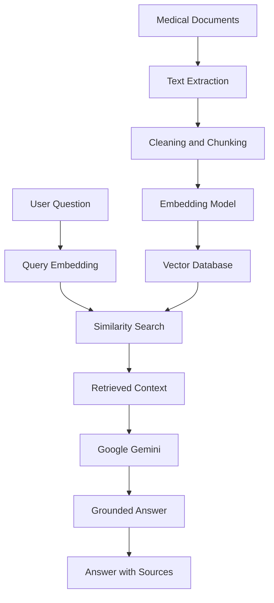

# MediQuery — Medical Knowledge, Made Accessible

<p align="center">
  <strong>An AI-powered medical knowledge assistant grounded in trusted documents.</strong>
</p>

<p align="center">
  Ask questions. Retrieve relevant evidence. Understand the answer.
</p>

<p align="center">
  <a href="#about-the-project">About</a> ·
  <a href="#features">Features</a> ·
  <a href="#getting-started">Getting Started</a> ·
  <a href="#roadmap">Roadmap</a> ·
  <a href="#contributing">Contributing</a>
</p>

<p align="center">
  
  
  
  
</p>

---

## About the Project

MediQuery is an AI-powered medical knowledge assistant designed to answer questions using information retrieved from a curated collection of medical documents.

General-purpose language models can produce fluent answers, but their responses may be outdated, unsupported, or incorrect. MediQuery explores how **Retrieval-Augmented Generation (RAG)** can improve answer grounding by retrieving relevant document passages before generating a response.

Instead of relying exclusively on a model's parametric knowledge, the system follows a retrieval-first workflow:

1. Ingest medical documents.
2. Extract and clean their text.
3. Split the text into searchable chunks.
4. Convert chunks into vector embeddings.
5. Retrieve relevant passages for a user's question.
6. Generate a response using Google Gemini and the retrieved context.
7. Provide source references to help users verify the information.

The project begins with a small, working prototype and is designed to evolve into a modular application with better retrieval, evaluation, observability, and deployment.

### Project Goals

- Build a practical RAG pipeline from the ground up.
- Understand document processing, embeddings, vector databases, and LLM integration.
- Ground generated answers in retrieved evidence.
- Make responses more transparent through source attribution.
- Develop a modular codebase that can support future improvements.
- Deploy an accessible demonstration without requiring a paid OpenAI API.

> **Important:** MediQuery is an experimental educational project, not a medical device or a substitute for professional medical advice. Generated answers can be inaccurate or incomplete. Medical decisions should be made with qualified healthcare professionals.

## Features

### Core Prototype

- [ ] Upload and ingest medical PDF documents.
- [ ] Extract, clean, and chunk document text.
- [ ] Generate vector embeddings.
- [ ] Store and search embeddings using a vector database.
- [ ] Generate context-grounded answers using Google Gemini.
- [ ] Display source documents and relevant passages.
- [ ] Provide a simple API for submitting questions.
- [ ] Handle missing or insufficient evidence without fabricating citations.

### Planned Enhancements

- [ ] Interactive web interface.
- [ ] Support for multiple document formats.
- [ ] Hybrid retrieval combining semantic and keyword search.
- [ ] Reranking for improved retrieval quality.
- [ ] Conversation history and follow-up questions.
- [ ] Automated retrieval and answer evaluation.
- [ ] Docker-based deployment.
- [ ] Production deployment with authentication and appropriate access controls.

*The checklist describes the project roadmap; it does not imply that every feature is already implemented.*

## How It Works



The ingestion pipeline processes documents before a user submits a question. At query time, the system searches the indexed content, selects relevant passages, and provides them as context to the language model.

Retrieval quality is a major determinant of answer quality. A fluent response is not necessarily a correct response, so source verification and evaluation are essential parts of the project.

## Built With

| Technology | Purpose |
|---|---|
| [Python](https://www.python.org/) | Core application language |
| [uv](https://docs.astral.sh/uv/) | Python project and dependency management |
| [FastAPI](https://fastapi.tiangolo.com/) | REST API |
| [Google Gemini](https://ai.google.dev/gemini-api/docs) | Context-grounded response generation |
| [Sentence Transformers](https://www.sbert.net/) | Text embedding generation |
| [ChromaDB](https://docs.trychroma.com/) | Vector storage and similarity search |
| [PyPDF](https://pypdf.readthedocs.io/) | PDF text extraction |
| [pytest](https://docs.pytest.org/) | Automated testing |

The stack is intended for the initial prototype. Individual components can be replaced as the application evolves.

**Cost note:** The prototype avoids the OpenAI API, but Gemini API usage may be subject to quotas, rate limits, and pricing. Local embedding models also require compute resources.

## Getting Started

Follow these steps to set up the project locally.

### Prerequisites

Make sure you have:

- Python 3.12 or a compatible version.
- `uv` installed.
- Git installed.
- A Google AI Studio API key for Gemini access.
- Medical documents that you have permission to use.

### 1. Install uv

If you have not installed `uv`, follow the [official installation guide](https://docs.astral.sh/uv/getting-started/installation/).

On Linux or macOS, you can use:

```bash
curl -LsSf https://astral.sh/uv/install.sh | sh
```

Restart your terminal if needed, then verify the installation:

```bash
uv --version
```

### 2. Clone the Repository

Replace the repository URL with your actual GitHub repository.

```bash
git clone https://github.com/YOUR_USERNAME/mediquery.git
cd mediquery
```

### 3. Install Dependencies

Install the project and its dependencies using `uv`:

```bash
uv sync
```

This creates or synchronizes the project virtual environment using `pyproject.toml` and `uv.lock`.

If you are setting up the project from scratch, add dependencies using:

```bash
uv add fastapi uvicorn pypdf sentence-transformers chromadb
uv add google-genai python-dotenv
uv add --dev pytest httpx ruff
```

Use the package names and versions specified by the actual project configuration if it already exists.

### 4. Configure Environment Variables

Create a `.env` file in the project root:

```bash
cp .env.example .env
```

Add your Google Gemini API key:

```dotenv
GEMINI_API_KEY=your_gemini_api_key_here
```

Obtain an API key through [Google AI Studio](https://aistudio.google.com/apikey).

Never commit `.env` or expose API keys in source code, screenshots, logs, or public repositories.

### 5. Run the Application

Once the API entry point has been implemented, start the development server with:

```bash
uv run uvicorn app.main:app --reload
```

Open the interactive API documentation at:

```text
http://127.0.0.1:8000/docs
```

The command assumes that the application entry point is `app/main.py` and exposes a FastAPI instance named `app`. Adjust it if your project uses a different structure.

## Project Structure

The intended structure separates document processing, retrieval, model integration, and API logic so that each component can be improved independently.

```text
mediquery/
├── app/
│   ├── main.py                 # FastAPI application
│   ├── config.py               # Environment and settings
│   ├── api/
│   │   └── routes.py           # API endpoints
│   ├── ingestion/
│   │   ├── loader.py           # Document loading
│   │   └── chunker.py          # Text chunking
│   ├── retrieval/
│   │   ├── embeddings.py       # Embedding generation
│   │   └── vector_store.py     # Vector search
│   ├── generation/
│   │   └── llm.py              # Gemini integration
│   └── services/
│       └── rag.py              # RAG orchestration
├── data/
│   └── documents/              # Local development documents
├── tests/
│   ├── test_ingestion.py
│   └── test_retrieval.py
├── .env.example
├── .gitignore
├── pyproject.toml
├── uv.lock
├── README.md
└── LICENSE
```

This is a proposed structure. Create modules as their functionality is implemented rather than adding empty files for every planned component.

## Usage

The intended interaction is straightforward:

1. Add permitted medical documents to the ingestion workflow.
2. Process the documents and index their text.
3. Submit a question through the API.
4. Retrieve relevant document passages.
5. Generate an answer using the retrieved context.
6. Review the answer alongside its source references.

For example, a user might ask:

> What are the common symptoms of iron-deficiency anemia according to the uploaded clinical reference?

The application should retrieve relevant passages and generate a response that distinguishes information supported by those passages from anything it cannot establish.

Example API requests and responses will be documented here once the corresponding endpoints are implemented.

## Safety and Responsible Use

Medical information requires particular care. MediQuery is being developed with the following principles in mind:

- **Evidence first:** Answers should be grounded in retrieved documents.
- **Source transparency:** Users should be able to inspect the passages supporting an answer.
- **Honest uncertainty:** The system should acknowledge when evidence is missing or conflicting.
- **Privacy:** Avoid uploading identifiable patient records unless the system has appropriate authorization, safeguards, and compliance measures.
- **No autonomous diagnosis:** The prototype is not intended to diagnose conditions, prescribe treatments, or replace a clinician.
- **Continuous evaluation:** Retrieval failures, unsupported claims, and misleading citations must be tested.

Retrieval and citations can reduce some risks, but they do not guarantee medical correctness or eliminate hallucinations.

## Roadmap

### Phase 1 — Working Prototype

- [ ] Initialize the project using `uv`.
- [ ] Configure Gemini securely.
- [ ] Load and extract text from medical PDFs.
- [ ] Implement chunking and embedding generation.
- [ ] Store embeddings and retrieve relevant passages.
- [ ] Generate answers grounded in retrieved context.
- [ ] Return source references through a FastAPI endpoint.
- [ ] Add basic automated tests.

### Phase 2 — Better Retrieval

- [ ] Experiment with chunk sizes and overlap.
- [ ] Evaluate embedding models.
- [ ] Add metadata filtering and hybrid retrieval.
- [ ] Introduce reranking.
- [ ] Measure retrieval precision and recall.
- [ ] Build a small evaluation dataset.

### Phase 3 — User Experience

- [ ] Build a chat interface.
- [ ] Support document uploads and indexing status.
- [ ] Display citations alongside answers.
- [ ] Add conversation context.
- [ ] Improve error handling and feedback.

### Phase 4 — Deployment and Reliability

- [ ] Containerize the application.
- [ ] Deploy a public demonstration.
- [ ] Add authentication and rate limiting where appropriate.
- [ ] Configure monitoring and structured logging.
- [ ] Add safeguards for document access and sensitive data.
- [ ] Evaluate performance, reliability, and operating costs.

See the [open issues](https://github.com/YOUR_USERNAME/mediquery/issues) for planned improvements and known problems.

## Testing

Run the test suite using:

```bash
uv run pytest
```

Run linting with:

```bash
uv run ruff check .
```

Testing should cover document extraction, chunk boundaries, retrieval relevance, API behavior, missing context, and failures from external model services.

## Contributing

Contributions, bug reports, documentation improvements, and constructive feedback are welcome.

1. Fork the repository.
2. Create a feature branch:

   ```bash
   git checkout -b feature/your-feature
   ```

3. Make your changes and add appropriate tests.
4. Run the test suite and lint checks.
5. Commit your changes:

   ```bash
   git commit -m "Add your feature"
   ```

6. Push the branch and open a pull request.

For major changes, open an issue first to discuss the proposed approach.

Please do not contribute private patient data, API keys, or copyrighted medical documents without the appropriate permissions.

## License

This project has not yet selected a license. Add a `LICENSE` file before publishing the repository as an open-source project.

A license such as MIT may be suitable for a learning-oriented project, provided its terms meet your requirements.

## Acknowledgments

- [Google AI for Developers](https://ai.google.dev/) for Gemini API documentation.
- [Astral](https://astral.sh/) for `uv`.
- The maintainers of FastAPI, Sentence Transformers, ChromaDB, and PyPDF.
- The open-source community working on retrieval-augmented generation and responsible AI.

---

<p align="center">
  <strong>MediQuery</strong>
  <br />
  Medical knowledge, grounded in evidence.
  <br />
  <sub>Built as an educational project exploring RAG, information retrieval, and responsible AI.</sub>
</p>

<p align="center">
  <a href="#readme-top">Back to top</a>
</p>
